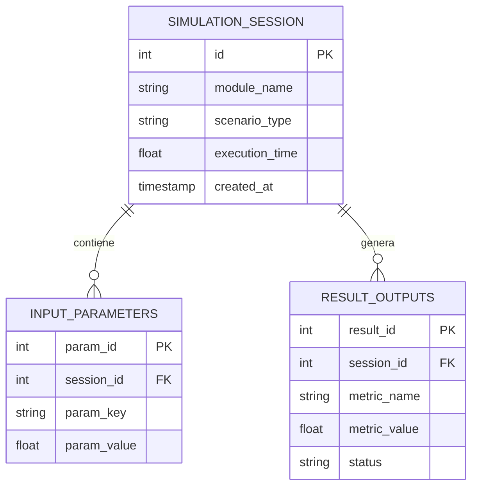

# Plataforma de Métodos Numéricos

**Autores:** Miguel Angel Benito Peñaloza & Daner Gabriel Huancollo Gaile  
**Carrera:** Ingeniería de Sistemas  
**Proyecto:** Simulación Numérica para Sistemas de Transporte por Cable (Caso de estudio: *Mi Teleférico*, La Paz, Bolivia)

---

## Descripción del Proyecto
**SIMTELE-RISK** es una solución computacional y académica diseñada para modelar, simular y analizar el comportamiento físico y operativo de un sistema de transporte por cable aéreo. Utilizando algoritmos avanzados de métodos numéricos, el software evalúa escenarios críticos de operación, distribuciones de tensión, errores de precisión y sistemas de ecuaciones lineales bajo diversas condiciones operativas (Normal, Estrés y Mal Condicionado).

---

## Módulos del Proyecto (Semana 1 y Semana 2)

1. **Módulo 1: Cinemática de Detención de Emergencia**
   - Simulación de frenado de emergencia mediante EDOs de movimiento (Runge-Kutta RK2 y RK4).
   - Cálculo de distancia de parada mediante integración numérica (Trapecio y Simpson).
2. **Módulo 2: Resolución de Sistemas Lineales ($A\mathbf{x} = \mathbf{b}$)**
   - Métodos Iterativos y Directos: **Jacobi**, **Gauss-Seidel**, **Descomposición LU** y **Gradiente Conjugado**.
   - Análisis de convergencia y errores relativos para matrices normales, con estrés y mal condicionadas.
3. **Módulo 3: Dinámica de Oscilaciones Amortiguadas por Viento**
   - Modelado de vibraciones en cables tractores ante ráfagas de viento laterales.
4. **Módulo 4: Reconstrucción de Sensores por Interpolación**
   - Ajuste de curvas y estimación de variables mediante polinomios de Lagrange, Newton y Splines Cúbicos.

---

##  Estructura del Repositorio

```text
desafiofinal- metodos/
│
├── index.html              
├── test_simtele.py         
└── README.md              
```

---

## Arquitectura y Base de Datos (Diagrama Entidad-Relación)

A continuación se muestra el esquema estructural de persistencia e historial integrado en la plataforma web mediante almacenamiento local (`localStorage`):



---

## Instrucciones de Uso y Pruebas Localmente

### 1. Interfaz Web (Calculadora Interactiva)
1. Descarga o clona este repositorio.
2. Abre el archivo **`index.html`** directamente en cualquier navegador web moderno (Chrome, Firefox, Edge).
3. Selecciona el módulo de tu interés e ingresa los parámetros numéricos para visualizar las gráficas de convergencia y los resultados en tiempo real.

### 2. Validación en Python
Para ejecutar las pruebas y corroborar la precisión numérica de los solvers matriciales:
```bash
python test_simtele.py
```
